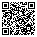

# 3DSaveSync

A Nintendo 3DS homebrew app (installed as a CIA) that backs up the save data and extdata of every
installed game to [Koofr](https://koofr.eu) over WebDAV. It keeps every version, and downloads any
version back into Checkpoint's folders so it can be restored with
[Checkpoint](https://github.com/BernardoGiordano/Checkpoint).

## Status

Work in progress. See the [implementation plan](docs/superpowers/plans/2026-11-12-3dsavesync.md)
for task-by-task progress, commits and every deviation from the plan.

| Part | State |
|---|---|
| Core logic (Checkpoint naming, manifests, WebDAV client, cloud layout, upload protocol, cleanup, backup runner, restore) | done, unit-tested on the PC |
| CIA build, app skeleton | done; runs in the Azahar emulator |
| Koofr login, HTTPS (curl + mbedTLS), first-launch setup | works on the console |
| Reading installed games, backup on launch, restore, delete versions, settings, sign out | built; waiting for the acceptance run on the console (plan Task 16) |

## How it works

What the app does; it is not yet checked on the console end to end.

- **Launch = backup.** Opening the app backs up every installed game (turn this off with "Back up
  on start" in Settings; the menu's "Sync now" then runs it). A game gets a new version only
  if its save data or extdata changed since its latest version. A version is always a full snapshot
  of both.
- **Nothing is overwritten.** Every run adds new versions next to the old ones. The app never deletes
  or replaces a complete version by itself; you delete versions by hand, with confirmation. The only
  automatic deletion is the app's own unfinished uploads.
- **Restore through Checkpoint.** Pick a game and a version. The app downloads it into
  `/3ds/Checkpoint/saves/<game>/<version>` (and `extdata/…`), verifies every file's SHA-256, and you
  restore it with Checkpoint. An existing local folder is never written into; a clash gets `-2`.
- **Credentials stay off the SD card.** The Koofr email and app password are typed once on the
  console and kept in the app's own save data, which the console encrypts with a console-unique key.

Cloud layout under the cloud folder (default `/3DSaveSync`):

```
saves/<0xNNNNN Game name>/<YYYYMMDD-HHMMSS>/...      save data
extdata/<0xNNNNN Game name>/<YYYYMMDD-HHMMSS>/...    extdata (if the game has any)
manifests/<0xNNNNN Game name>/<YYYYMMDD-HHMMSS>.manifest
.incoming/...                                        uploads in progress
```

Full details: [design](docs/superpowers/specs/2026-11-12-3dsavesync-design.md) and
[screen mockups](docs/superpowers/mockups-2026-11-12-screens.html).

## Requirements

**On the console:** a 3DS with Luma3DS, Checkpoint (for the restore step), FBI (to install the CIA),
and Wi-Fi.

**Koofr:** an account and an **app password**. Generate it in Koofr's web interface (preferences →
password → app passwords). The account password you use in the browser does not work for WebDAV:
Koofr answers HTTP 401.

**Build machine (Arch Linux):**

1. devkitPro, following the [devkitPro pacman guide](https://devkitpro.org/wiki/devkitPro_pacman):
   ```
   sudo pacman-key --recv BC26F752D25B92CE272E0F44F7FD5492264BB9D0 --keyserver keyserver.ubuntu.com
   sudo pacman-key --lsign BC26F752D25B92CE272E0F44F7FD5492264BB9D0
   sudo pacman -U https://pkg.devkitpro.org/devkitpro-keyring.pkg.tar.zst
   ```
   Add to `/etc/pacman.conf`:
   ```
   [dkp-libs]
   Server = https://pkg.devkitpro.org/packages

   [dkp-linux]
   Server = https://pkg.devkitpro.org/packages/linux/$arch/
   ```
   Then:
   ```
   sudo pacman -Syu
   sudo pacman -S 3ds-dev 3ds-curl 3ds-mbedtls 3ds-tinyxml2
   ```
2. CIA tools from the AUR: `projectctr-makerom` (or `projectctr-makerom-bin`) and `bannertool-git`.
3. For the PC unit tests: `gcc`, `make`, `tinyxml2`, `curl` (already installed on Arch; the tests
   use its headers and library).

## Build

```
make          # 3DSaveSync.3dsx and 3DSaveSync.elf
make cia      # 3DSaveSync.cia (needs makerom and bannertool)
make clean
```

`DEVKITPRO` defaults to `/opt/devkitpro` and `DEVKITARM` to `$DEVKITPRO/devkitARM` when they are not
set in the environment.

## Test

```
make -C tests
```

Builds `source/core/`, `source/platform/curl_error.cpp` and `source/platform/sd_fs.cpp` with the
host compiler and runs the doctest suite (`sd_fs` is tested in a temporary folder under `/tmp`). The core code has no libctru dependency; the console-specific parts are behind small
interfaces and are checked on the console.

## Releases

Push a tag that starts with `v`:

```
git tag v0.1.0
git push origin v0.1.0
```

GitHub Actions (`.github/workflows/release.yml`) then:

1. runs the PC tests in an `archlinux` container;
2. builds the CIA in the `devkitpro/devkitarm:20260610` container, with makerom `v0.19.0` and
   bannertool (commit `51dac92`) built from source by `tools/build-cia-tools.sh` and cached;
3. publishes a GitHub release named after the tag, with `3DSaveSync.cia` and `3DSaveSync-qr.png`
   (a QR code of that version's CIA link) attached; the notes show the QR code, the direct link and
   the commits since the previous release.

If the tests fail, nothing is published. Pushes without a tag do not run the workflow.

## Install and run

- **Console, over the internet:** in FBI choose Remote Install → Scan QR Code and scan this code. It
  always points to the CIA of the latest release
  (`https://github.com/NuclleaR/3DSaveSync/releases/latest/download/3DSaveSync.cia`). Each release's
  notes also carry a QR code for that exact version.

  

- **Console, from the SD card:** take `3DSaveSync.cia` from a GitHub release (or build it), copy it
  to the SD card (or serve it over the network) and install it with FBI. The app appears on the HOME Menu. On first launch it asks for the Koofr email and app
  password (system keyboard), tests the login, and stores them in its own save data.
- The console's date and time must be right: the Koofr certificate check fails otherwise.
- **Emulator, for quick UI checks:** in [Azahar](https://github.com/azahar-emu/azahar), `File →
  Install CIA…`. The emulator cannot stand in for the console: it does not see the console's games
  and does not reproduce Luma or the CIA's access permissions.

## Koofr WebDAV probe

```
bash tools/koofr-probe.sh
```

Asks for the Koofr email and app password, then exercises MKCOL, PUT, PROPFIND, MOVE
(`Overwrite: F`), GET and DELETE in a temporary `/3DSaveSync-probe` folder that it removes at the end.
It refuses to start if that folder already exists. It prints only status codes and saves one
PROPFIND response to `tests/fixtures/koofr-propfind.xml`. Credentials live in a temporary netrc
file that is deleted on exit. Run it in your own terminal so the password is never logged anywhere.

## Project layout

```
source/main.cpp        app entry: settings or setup, backup on launch, screen switching
source/core/           hardware-free logic, unit-tested on the PC
source/platform/       3DS implementations: curl transport, settings store, keyboard,
                       installed games and their archives, SHA-256, SD card, clock
source/ui/             citro2d screens (setup, sync, menu, restore, delete, settings),
                       lists, the background worker
tests/                 doctest suite, fakes and fixtures
tools/koofr-probe.sh   Koofr WebDAV probe
tools/build-cia-tools.sh  builds makerom and bannertool from source (used by CI)
tools/make-art.sh      draws resources/icon.png and resources/banner.png (ImageMagick)
.github/workflows/     release workflow
resources/             RSF, icon and banner (drawn by tools/make-art.sh), banner sound (silence)
romfs/cacert.pem       Mozilla CA bundle from curl.se, used to verify Koofr's certificate
docs/superpowers/      design, implementation plan, screen mockups
docs/fbi-install-qr.svg  QR code of the latest release's CIA link
                       (qrencode -t SVG -m 2 -o docs/fbi-install-qr.svg <link>)
```

To refresh the CA bundle, download `https://curl.se/ca/cacert.pem` into `romfs/`, compare its
SHA-256 with `https://curl.se/ca/cacert.pem.sha256`, and rebuild. The bundled copy is dated
2026-11-05.

## License

GPL-3.0-or-later; see [LICENSE](LICENSE).

Parts are adapted from [Checkpoint](https://github.com/BernardoGiordano/Checkpoint) (Copyright (C)
2017-2026 Bernardo Giordano, FlagBrew, GPLv3 or later, with Additional Terms 7.b and 7.c):
- the extdata-id and system-title tables in `source/core/checkpoint.cpp`;
- the access lists in `resources/app.rsf`.

Both files keep Checkpoint's notice and say how they were modified.
